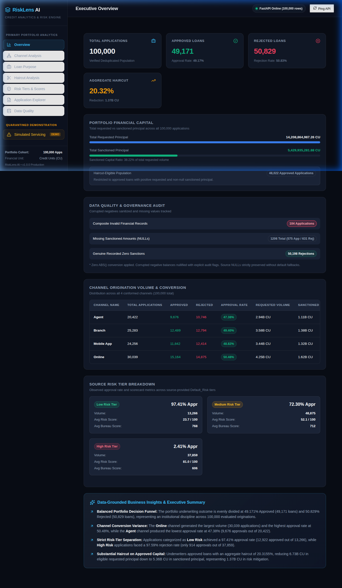
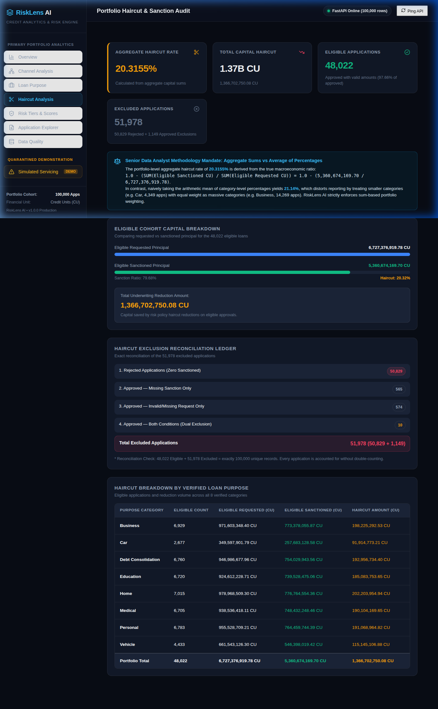
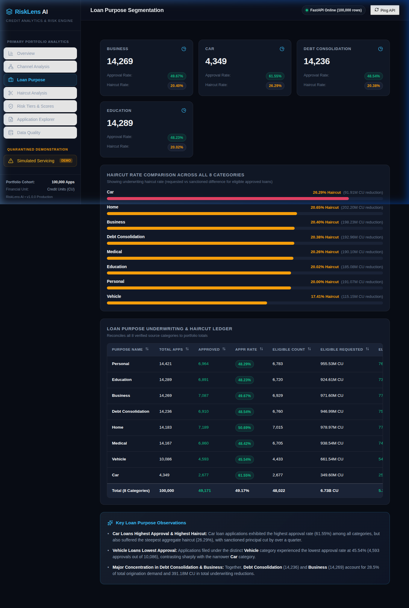
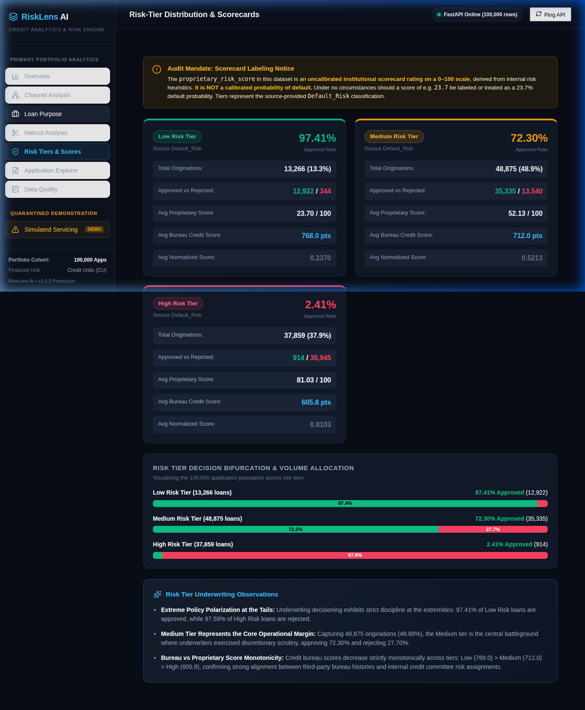
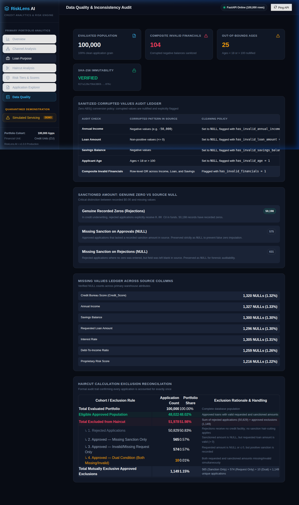
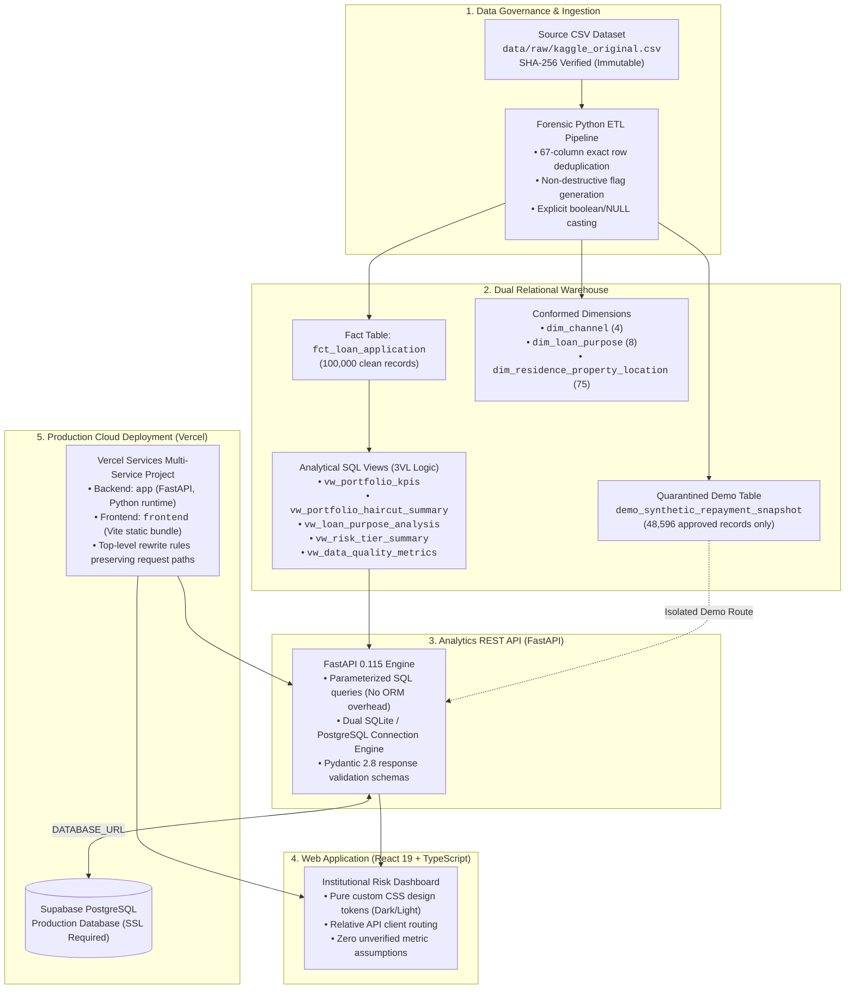

# RiskLens AI — Financial Risk Intelligence & Business Analytics

[](https://financial-risk-analysis-nine.vercel.app/)
[](https://github.com/Aravanant/financial-risk-analysis)
[](https://www.python.org/)
[](https://fastapi.tiangolo.com/)
[](https://supabase.com/)
[](https://react.dev/)
[](https://www.typescriptlang.org/)
[](https://vitejs.dev/)

> **RiskLens AI** is an institutional credit underwriting analytics warehouse, REST API, and forensic reporting dashboard. Built to demonstrate data auditing, 3-Valued Logic (3VL) SQL modeling, underwriting haircut reconciliation, and audit-flag profiling across **100,000 credit applications**.

---

## 1. Executive Summary & Live Application

In retail and commercial credit operations, analytical reporting often breaks down due to silent data mutations—such as auto-converting negative balances with `ABS()`, treating missing loan facilities as zero dollars, or taking unweighted averages of percentage haircuts across disparate loan sizes.

**RiskLens AI** establishes an audit-ready, reproducible data pipeline and business intelligence platform:
- **Business Problem:** Reconcile requested loan principal against sanctioned facilities, quantify underwriting haircuts, isolate missing data from legitimate zeros, and surface risk-tier concentrations.
- **Analytical Solution:** Cryptographically verified raw data ingestion, non-destructive audit flagging, star-schema dimensional modeling, dual-database persistence (SQLite locally, Supabase PostgreSQL in production), and a responsive React 19 dashboard.
- **Audience:** Credit Committee Executives, Portfolio Risk Managers, Lead Data Analysts, and Risk Analytics Auditors.

| Resource | URL | Verification Status |
| :--- | :--- | :--- |
| **Production Application** | [financial-risk-analysis-nine.vercel.app](https://financial-risk-analysis-nine.vercel.app/) | **Live & Verified** (Connected to Supabase PostgreSQL) |
| **API Health Endpoint** | [financial-risk-analysis-nine.vercel.app/health](https://financial-risk-analysis-nine.vercel.app/health) | **HTTP 200 OK** (`database_backend: postgresql`) |
| **OpenAPI / Swagger Docs** | [financial-risk-analysis-nine.vercel.app/docs](https://financial-risk-analysis-nine.vercel.app/docs) | **Interactive API Explorer** |
| **GitHub Repository** | [github.com/Aravanant/financial-risk-analysis](https://github.com/Aravanant/financial-risk-analysis) | **Public Source Code & Audit Artifacts** |

---

## 2. Dashboard Interface Tour

The screenshots below are authentic captures from the live production deployment.

### Executive Portfolio Overview
High-level summary of total applications, approval/rejection rates, requested versus sanctioned principal, haircut metrics, risk tiers, and channel distribution.


### Underwriting Haircut & Exclusion Ledger
Comprehensive analysis of the 20.32% aggregate haircut, tracking sanctioned facility reductions and the mutually exclusive 4-part exclusion ledger.


### Loan Purpose Segmentation
Category-level breakdown across all 8 credit purposes, comparing requested volumes, approval rates, and purpose-specific haircut rates.


### Risk Tier & Scorecard Analysis
Segmentation across Low, Medium, and High risk tiers, linking proprietary risk scores (0–100) to bureau credit scores and approval outcomes.


### Data Quality & Audit Flag Ledger
Forensic ledger tracking negative financial inputs, demographic flags, and strict distinction between `NULL` entries and recorded zero amounts.


---

## 3. Business Problem & Solution

Credit risk analytics requires strict distinction between borrower demand (requested amount) and institutional commitment (approved amount). When analyzing 100,000 credit applications, RiskLens AI provides structured analytical visibility into five core business areas:

1. **Approval & Rejection Dynamics:** Full visibility into approval rates across origination channels, credit tiers, and loan purposes without dropping unapproved records.
2. **Underwriting Haircut Quantified:** Measurement of the variance between requested loan amounts and sanctioned credit facilities, helping portfolio managers understand credit rationing.
3. **Risk Tier & Scorecard Profiling:** Evaluation of applicant distributions across Low, Medium, and High risk tiers alongside external bureau credit scores.
4. **Data Quality Governance:** Pre-decision profiling that detects negative financial inputs, impossible ages, and missing fields before analytical aggregation.
5. **Application-Level Traceability:** Granular record exploration with multi-attribute filtering, allowing risk officers to inspect individual applications.

*Note: RiskLens AI presents historical analytical capabilities and portfolio accounting; it does not claim to automate live lending decisions or guarantee loan recoveries.*

---

## 4. Key Business Insights & Verified Portfolio Metrics

All figures below are calculated from the verified 100,000 deduplicated application warehouse and confirmed via the live API:

| Metric Name | Value | Cohort / Denominator | Business Definition |
| :--- | :---: | :--- | :--- |
| **Total Evaluated Applications** | **100,000** | Full deduplicated portfolio | Total loan applications evaluated by the institution after removing 150 duplicate row clones. |
| **Approved Applications** | **49,171** | 100,000 applications | Applications approved by the credit committee (**49.171%** approval rate). |
| **Rejected Applications** | **50,829** | 100,000 applications | Applications denied credit facilities (**50.829%** rejection rate). |
| **Haircut-Eligible Approved Cohort** | **48,022** | Approved loans meeting 3 criteria | Approved applications with valid requested amount $> 0$ and non-null sanctioned facility. |
| **Total Requested Principal (Portfolio)** | **14,208,864,987.26 CU** | All 100,000 applications | Gross loan principal requested by all applicants across the portfolio. |
| **Total Sanctioned Principal (Portfolio)** | **5,429,935,281.88 CU** | All 100,000 applications | Gross credit principal approved and sanctioned by underwriters. |
| **Eligible Requested Principal** | **6,727,376,919.78 CU** | 48,022 eligible cohort | Requested principal within the haircut-eligible approved cohort. |
| **Eligible Sanctioned Principal** | **5,360,674,169.70 CU** | 48,022 eligible cohort | Actual credit facility granted to the haircut-eligible approved cohort. |
| **Aggregate Underwriting Haircut** | **1,366,702,750.08 CU** | $\sum \text{Requested} - \sum \text{Sanctioned}$ | Total monetary haircut applied to approved borrowing requests during underwriting. |
| **Aggregate Haircut Rate** | **20.32%** (20.3155%) | $\frac{\text{Eligible Haircut CU}}{\text{Eligible Requested CU}}$ | True weighted reduction percentage: $1 - \frac{5,360,674,169.70}{6,727,376,919.78}$. |

> [!NOTE]
> **Currency Units (CU):** Financial figures are reported in **CU (Currency Units)** because the raw source dataset does not specify a sovereign currency denomination (USD, EUR, GBP, INR). RiskLens AI avoids unverified currency conversions.

### Aggregate Ratios vs. Average of Ratios
A common analytical error in credit portfolio reporting is averaging application-level haircut percentages ($\frac{1}{N} \sum \frac{R_i - S_i}{R_i}$). In homogeneous portfolios, this inflates small loan reductions. RiskLens AI enforces **aggregate sum-based weighting**:
$$\text{Aggregate Haircut Rate} = 1 - \frac{\sum_{i=1}^{N} \text{Sanctioned}_i}{\sum_{i=1}^{N} \text{Requested}_i} = 1 - \frac{5,360,674,169.70}{6,727,376,919.78} = \mathbf{20.3155\%}$$

### Loan Purpose Breakdown (All 8 Verified Categories)

| Loan Purpose Category | Total Applications | Share of Portfolio | Approved Count | Rejected Count | Approval Rate | Total Requested (CU) | Total Sanctioned (CU) | Aggregate Haircut (%) |
| :--- | :---: | :---: | :---: | :---: | :---: | :---: | :---: | :---: |
| **Personal** | 14,421 | 14.42% | 6,964 | 7,457 | 48.29% | 2,051,826,588.70 | 774,945,106.58 | 20.00% |
| **Education** | 14,289 | 14.29% | 6,891 | 7,398 | 48.23% | 2,026,642,586.82 | 750,392,291.06 | 20.02% |
| **Business** | 14,269 | 14.27% | 7,087 | 7,182 | 49.67% | 2,018,127,261.68 | 782,181,290.77 | 20.40% |
| **Debt Consolidation** | 14,236 | 14.24% | 6,910 | 7,326 | 48.54% | 2,010,279,716.67 | 762,489,028.84 | 20.38% |
| **Home** | 14,183 | 14.18% | 7,189 | 6,994 | 50.69% | 2,000,021,248.92 | 788,125,042.79 | 20.65% |
| **Medical** | 14,167 | 14.17% | 6,860 | 7,307 | 48.42% | 2,019,030,030.13 | 758,069,310.24 | 20.26% |
| **Vehicle** | 10,086 | 10.09% | 4,593 | 5,493 | 45.54% | 1,485,089,963.45 | 556,050,083.02 | 17.41% |
| **Car** | 4,349 | 4.35% | 2,677 | 1,672 | 61.55% | 597,847,590.89 | 257,683,128.58 | 26.29% |
| **Total / Overall** | **100,000** | **100.00%** | **49,171** | **50,829** | **49.17%** | **14,208,864,987.26** | **5,429,935,281.88** | **20.32%** |

---

## 5. Dashboard Features & Analytical Views

The dashboard implements eight distinct analytical tabs, each addressing specific risk and business questions:

| Tab Name | Core Business Question Answered | Value to Credit & Business Analysts |
| :--- | :--- | :--- |
| **1. Overview** | *"What is the overall financial scale, approval throughput, and risk distribution of the portfolio?"* | Executive visibility into high-level volume, approval/rejection rates, aggregate haircut totals, and channel mix. |
| **2. Channel Analysis** | *"Which origination channels deliver the highest credit quality versus application volume?"* | Evaluates performance across Online, Branch, Mobile App, and Agent channels to identify volume and quality divergence. |
| **3. Loan Purpose** | *"How do approval rates, requested capital, and sanction haircuts vary across borrower loan purposes?"* | Highlights sector concentrations and risk patterns across all 8 verified borrowing categories. |
| **4. Haircut Analysis** | *"What is the aggregate credit haircut rate, and how are non-eligible applications accounted for?"* | Reconciles requested versus approved principal while surfacing the 4-part mutually exclusive exclusion ledger. |
| **5. Risk Analysis** | *"How do internal risk tiers correlate with external bureau credit scores and approval decisions?"* | Validates scorecard separation across Low, Medium, and High risk tiers against empirical underwriting outcomes. |
| **6. Application Explorer** | *"What specific demographic, financial, and risk attributes characterize individual applications?"* | Paginated record browser with multi-field filtering and interactive slide-out drawer for application inspection. |
| **7. Data Quality** | *"What data anomalies exist in the underlying warehouse, and how are nulls separated from zeros?"* | Forensic audit ledger displaying flags for negative incomes, invalid ages, and missing sanctioned facilities. |
| **8. Servicing Demo** | *"How would an isolated loan servicing repayment schedule behave on eligible approved loans?"* | Demonstrates downstream servicing calculations in a strictly quarantined sandbox, preventing underwriting metric contamination. |

---

## 6. System Architecture & Data Flow



### Architectural Layer Responsibilities
- **Data Governance Layer:** Verifies source file immutability via SHA-256 (`027a120ef9bb38697331dd6f58dc06a84d86ac59fddcd388e3d37c6222ee076c`). Deduplicates raw records and applies non-destructive audit flags.
- **Data Warehouse Layer:** Star-schema dimensional model with strict foreign keys and CHECK constraints. Analytical SQL views use 3-Valued Logic to preserve `NULL`s versus zeros.
- **Backend Service Layer:** High-performance, read-only FastAPI service using parameterized SQL queries. Employs a dual-database adapter: local SQLite by default, or Supabase PostgreSQL when `DATABASE_URL` is set.
- **Frontend Presentation Layer:** Built with React 19, TypeScript, and Vite. Implements clean client-side routing, accessible UI controls, and strict Currency Unit (CU) notation.
- **Production Infrastructure:** Hosted on Vercel Services in a unified multi-service project, routing `/api/*` and `/health` to FastAPI and all remaining paths to the Vite SPA.

---

## 7. Data Methodology & KPI Definitions

### 1. Deduplication Policy
The raw dataset contains 100,151 rows (1 header + 100,150 data records). A 67-column exact byte-for-byte comparison identified **150 exact duplicates**. These were removed during ETL ingestion, establishing an analytical population of **100,000 distinct loan applications** with unique `application_id`s from 500,001 to 600,000.

### 2. Non-Destructive Data Cleaning (No `ABS()`)
Negative financial values and impossible ages represent data-quality defects. Rather than silently modifying signs with `ABS()` or dropping rows, RiskLens AI sets invalid values to `NULL` in analytical columns and flags them in explicit audit columns:
- `has_invalid_annual_income`: Flagged when `Annual_Income < 0` (27 records).
- `has_invalid_loan_amount`: Flagged when `Loan_Amount <= 0` (2 records).
- `has_invalid_savings_balance`: Flagged when `Savings_Account_Balance < 0` (76 records).
- `has_invalid_financials`: Composite boolean covering all three financial defects (**104 unique applications**; application 530,545 triggered both loan amount and savings balance defects).
- `has_invalid_age`: Flagged when `Age < 18 OR Age > 100` (25 records).

### 3. Mutually Exclusive Haircut Accounting Ledger
To avoid double-counting exclusions in haircut calculations, the 100,000 applications are partitioned into **mutually exclusive cohorts**:

```
Total Applications (100,000)
├── Haircut-Eligible Approved (48,022) [48.02%]
└── Excluded Applications (51,978) [51.98%]
    ├── Rejected Applications (50,829) [50.83%]
    └── Approved Exclusions (1,149) [1.15%]
        ├── Missing Sanction Only (565) [0.57%]
        ├── Invalid/Missing Request Only (574) [0.57%]
        └── Dual Condition / Both Missing (10) [0.01%]
```

| Exclusion Category | Application Count | Share of Excluded | Share of Portfolio | Underwriting Accounting Rationale |
| :--- | :---: | :---: | :---: | :--- |
| **1. Rejected Applications** | 50,829 | 97.79% | 50.83% | Legitimate credit denials; zero facility disbursed. |
| **2. Approved — Missing Sanction Only** | 565 | 1.09% | 0.57% | Approved with valid request, but sanction amount is `NULL`. |
| **3. Approved — Invalid/Missing Request Only** | 574 | 1.10% | 0.57% | Approved with recorded sanction, but request is missing or $\le 0$. |
| **4. Approved — Dual Condition (Both Missing)** | 10 | 0.02% | 0.01% | Approved with both requested and sanctioned amounts invalid/missing. |
| **Total Excluded Applications** | **51,978** | **100.00%** | **51.98%** | $50,829 + 565 + 574 + 10 = \mathbf{51,978}$ |
| **Haircut-Eligible Cohort** | **48,022** | — | **48.02%** | Approved loans meeting all 3 validity criteria. |
| **Total Balanced Portfolio** | **100,000** | — | **100.00%** | $48,022 + 51,978 = \mathbf{100,000}$ |

---

## 8. Dataset Limitations & Responsible Interpretation

RiskLens AI adheres to strict data transparency and disclosure standards:

1. **Unverified Currency Denomination:** Monetary amounts are labeled as **CU (Currency Units)** because the source dataset does not specify currency.
2. **Synthetic Data Characteristics:** The dataset contains synthetic extension fields and simulated artifacts. These metrics represent analytical exercises and must not be interpreted as real-world lending outcomes.
3. **Absence of Current Loan Default Outcomes:** The dataset does not contain an empirical post-origination default or charge-off event for current loans. Standard "default prediction" models cannot be legitimately trained on this data.
4. **Historical vs. Current Default Status:** `Previous_Loan_Status = Defaulted` indicates an applicant defaulted on a past loan from an earlier lender years ago, not on the evaluated application.
5. **Scorecard Interpretation:** `Risk_Score` (0–100) and `Default_Risk` (Low/Medium/High) represent categorical scorecard ratings, not calibrated default probabilities.
6. **Repayment Quarantine on Rejected Loans:** In the raw dataset, all 50,907 rejected loans had artificial repayment schedules attached (49,464 had positive paid amounts). RiskLens AI quarantined this synthetic servicing data, restricting repayment demonstrations strictly to approved loans.
7. **Observational Associations:** Cross-tabulations and observed ratios reflect historical patterns in the data and do not establish causal relationships.

---

## 9. Technology Stack

| Technology | Version / Specification | Architectural Role | Value Contributed |
| :--- | :--- | :--- | :--- |
| **Python** | 3.12 / 3.10+ | Core Backend & ETL Engine | Data pipelines, cryptographic verification, and analytical orchestration. |
| **FastAPI** | 0.115+ | REST API Framework | High-speed ASGI routing, Pydantic data validation, and auto-generated OpenAPI documentation. |
| **PostgreSQL** | Supabase Cloud (v15+) | Production Data Warehouse | Cloud relational storage with SSL enforcement, indexing, and analytical view execution. |
| **SQLite 3** | 3.x (WAL mode) | Local Development & Testing | Zero-configuration local database for unit tests and offline development. |
| **React** | 19.0+ | Frontend Framework | Declarative component state management and dashboard interface rendering. |
| **TypeScript** | 5.0+ | Frontend Language | End-to-end type safety matching backend Pydantic API response contracts. |
| **Vite** | 6.0+ | Build Tooling & Dev Server | Fast frontend bundling and proxy development server. |
| **Vercel Services** | Multi-service preset | Cloud Hosting Platform | Serverless Python backend and Vite frontend hosted under a single project domain. |
| **unittest & httpx** | Standard Library / TestClient | Automated Test Suites | 59 automated unit, integration, and SQL reconciliation tests. |

---

## 10. Setup & Local Execution

### Prerequisites
- **Python 3.10+** (Python 3.12 recommended)
- **Node.js 18+** and **npm**
- **Git**

### 1. Clone the Repository
```bash
git clone https://github.com/Aravanant/financial-risk-analysis.git
cd financial-risk-analysis
```

### 2. Backend Setup
```bash
# Create and activate Python virtual environment
python3 -m venv .venv
source .venv/bin/activate  # On Windows: .venv\Scripts\activate

# Install backend dependencies
pip install -r requirements.txt

# Start the FastAPI analytics backend (uses local SQLite warehouse by default)
uvicorn src.api.main:app --reload --host 127.0.0.1 --port 8000
```
Verify the API is running at `http://127.0.0.1:8000/health`.

### 3. Frontend Setup
In a separate terminal window:
```bash
cd frontend

# Install Node dependencies
npm install

# Start Vite development server
npm run dev
```
Open `http://localhost:5173` in your browser.

### 4. Optional: Supabase PostgreSQL Configuration
To connect the local backend to Supabase PostgreSQL rather than SQLite:
```bash
export DATABASE_URL="postgresql://postgres:[PASSWORD]@[HOST]:5432/postgres?sslmode=require"
uvicorn src.api.main:app --reload
```

---

## 11. API Reference & Automated Verification

### Verified API Endpoints

| Endpoint | HTTP Method | Response Schema | Purpose |
| :--- | :---: | :--- | :--- |
| `/health` | `GET` | `HealthResponse` | System health, database connectivity backend, and record counts. |
| `/api/v1/overview` | `GET` | `PortfolioKPIs` | Aggregate application counts, approval rates, and requested/sanctioned CU. |
| `/api/v1/channels` | `GET` | `List[ChannelPerformanceItem]` | Origination channel volumes, approval rates, and average credit scores. |
| `/api/v1/loan-purposes` | `GET` | `List[LoanPurposeItem]` | Breakdown across all 8 credit categories with volume and sanction figures. |
| `/api/v1/haircut` | `GET` | `HaircutResponse` | Comprehensive haircut rates, eligible sums, and exclusion ledger counts. |
| `/api/v1/risk-tiers` | `GET` | `List[RiskTierItem]` | Risk tier distribution, approval percentages, and average scorecard values. |
| `/api/v1/data-quality` | `GET` | `DataQualityResponse` | Audit flags, missing values, and NULL vs. recorded zero reconciliation. |
| `/api/v1/applications` | `GET` | `PaginatedApplicationsResponse` | Paginated search with filtering (`page`, `page_size`, `decision`, `risk_tier`). |
| `/api/v1/demo/servicing-snapshot/{id}` | `GET` | `ServicingDemoResponse` | Quarantined demonstration repayment schedules for approved applications. |

### Running the Automated Test Suite
```bash
# Execute all 59 backend integration, schema, and SQL view tests
python3 -m unittest discover -s tests
```
**Test Result:** `Ran 59 tests in 44.955s — OK (0 failures, 0 errors)`.

### Running the Frontend Production Build
```bash
npm --prefix frontend run build
```
**Build Result:** `tsc -b && vite build` completed with exit code `0`.

---

## 12. Business Skills & Competencies Demonstrated

This project showcases core competencies for **Data Analyst**, **Business Analyst**, **Business Data Analyst**, and **Quantitative Risk Associate** roles:

- **Metric Formulation & Reconciliation:** Designing mathematically sound aggregate KPIs (avoiding average-of-ratios bias) and building mutually exclusive accounting ledgers.
- **Forensic Data Profiling:** Auditing raw data for structural defects, cryptographic immutability, and distinguishing genuine zeros from missing values.
- **Dimensional Data Modeling:** Architecting star-schema tables, conformed dimensions, surrogate keys, and SQL views with 3-Valued Logic.
- **Full-Stack Analytical Engineering:** Implementing typed REST APIs and connecting cloud databases to interactive React dashboards.
- **Transparent Risk Communication:** Rigorously documenting data caveats, avoiding unsubstantiated causality claims, and maintaining institutional governance standards.

---

## 13. Future Roadmap

- [ ] **Automated Data Drift Monitoring:** Scheduled data-quality profiling jobs with alerting for statistical distribution shifts.
- [ ] **Semantic Layer Contracts:** Standardizing KPI definitions via semantic metric specifications (e.g., dbt semantic layer / Cube).
- [ ] **Empirical Default Outcome Dataset:** Integrating a fully labeled, verified post-origination loan charge-off dataset for machine learning risk modeling.
- [ ] **Role-Based Access Control (RBAC):** Implementing multi-tenant authentication and field-level permissioning for sensitive demographic data.

---

## 14. Author & Repository Information

- **Project Lead & Developer:** Aravanant ([@Aravanant](https://github.com/Aravanant))
- **Email:** scighd@gmail.com
- **Repository:** [https://github.com/Aravanant/financial-risk-analysis](https://github.com/Aravanant/financial-risk-analysis)
- **Production Deployment:** [https://financial-risk-analysis-nine.vercel.app](https://financial-risk-analysis-nine.vercel.app/)

---
*RiskLens AI — Developed for institutional data governance, credit risk intelligence, and transparent financial analysis.*
