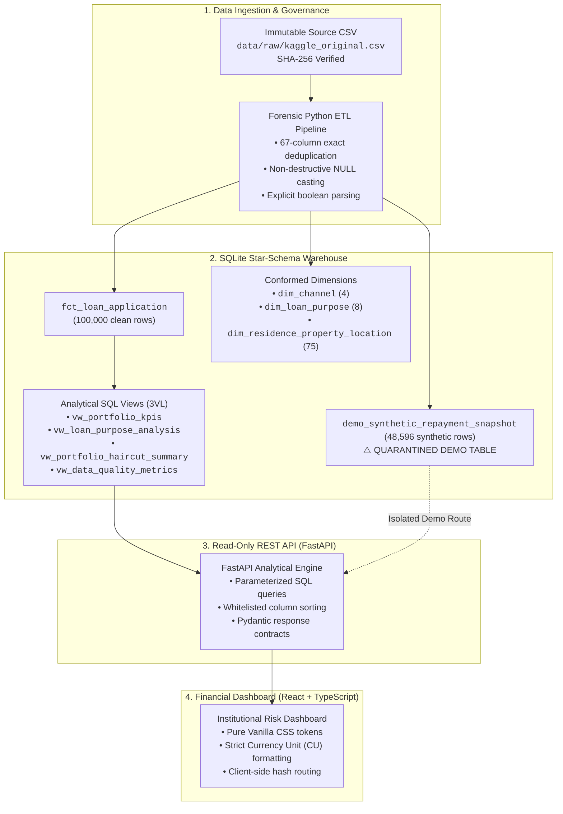
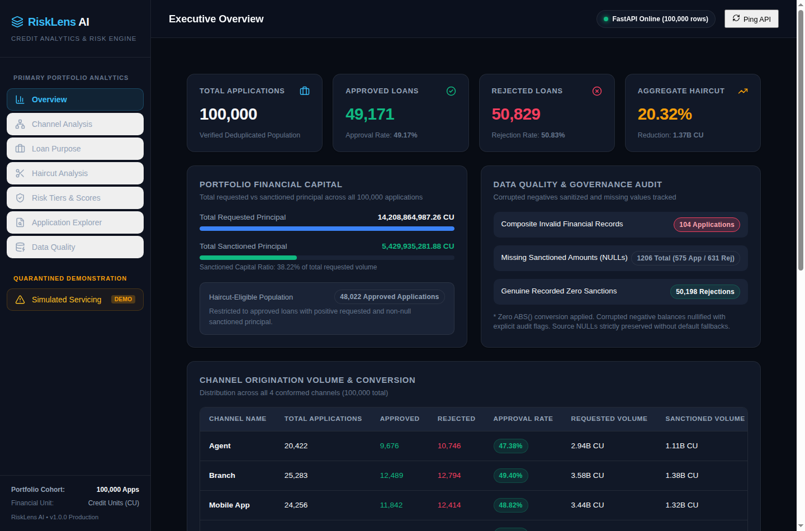
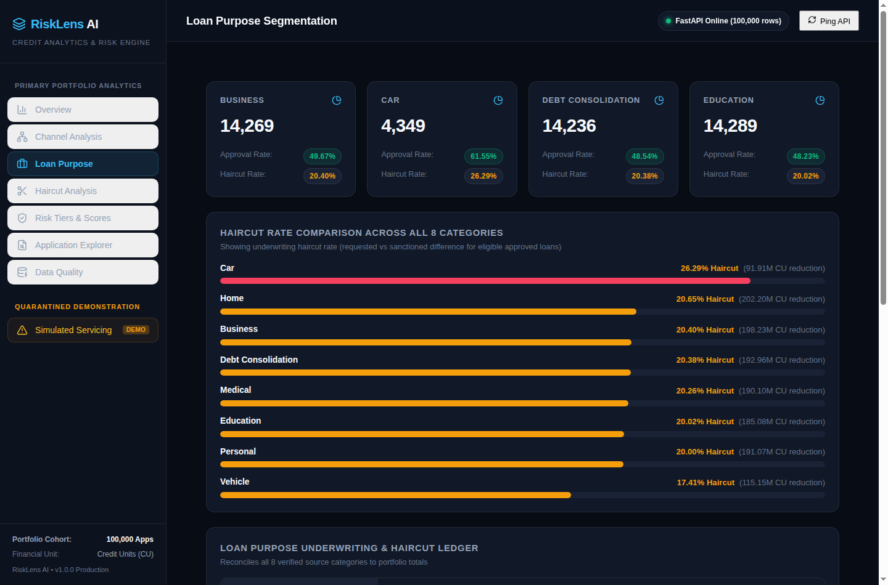
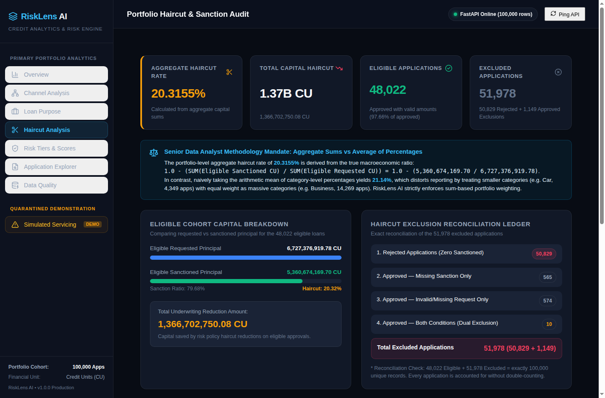
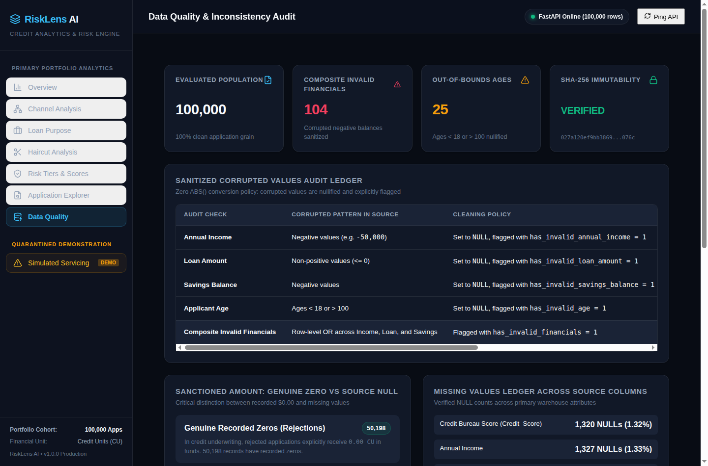
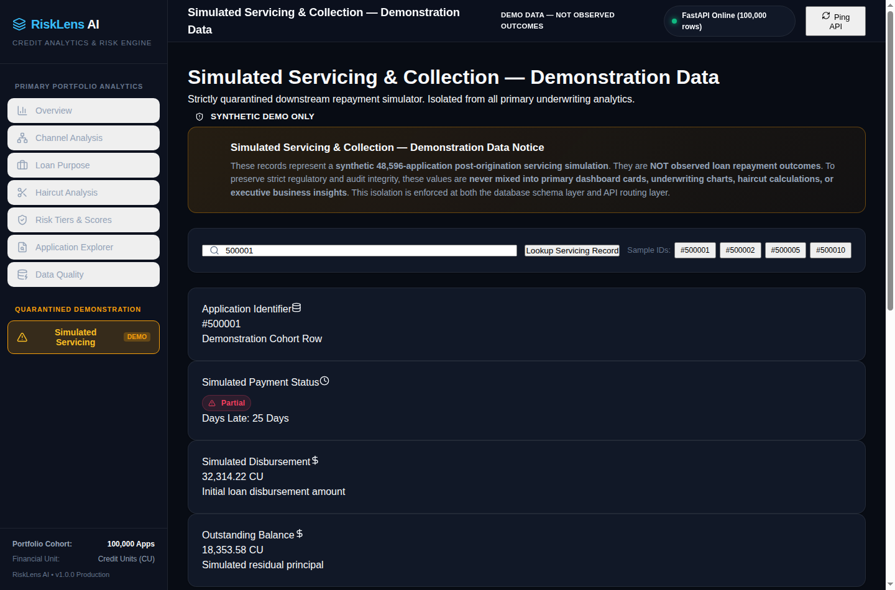
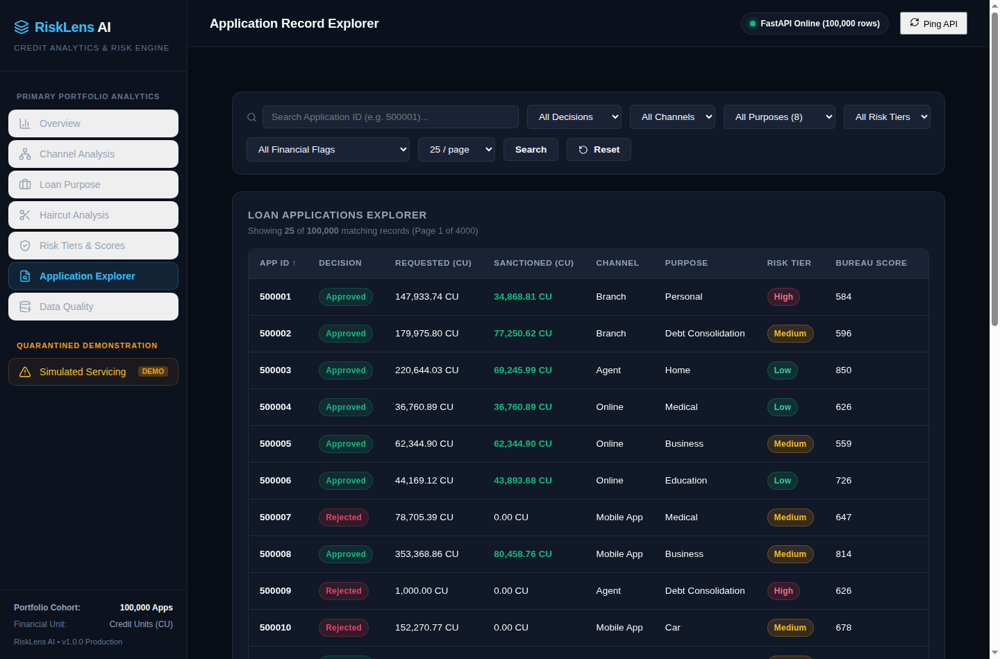
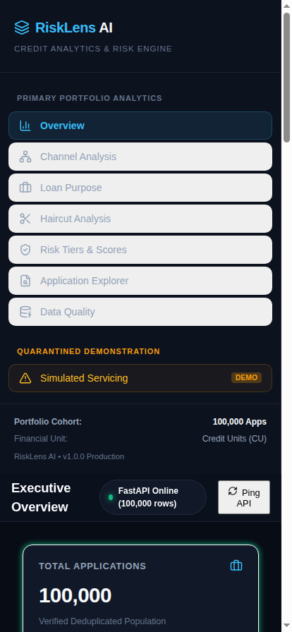

# RiskLens AI — Financial Risk & Credit Underwriting Intelligence

[](https://www.python.org/)
[](https://fastapi.tiangolo.com/)
[](https://www.sqlite.org/)
[](https://react.dev/)
[](https://www.typescriptlang.org/)
[](https://vitejs.dev/)

> **RiskLens AI** is an end-to-end financial analytics warehouse, credit underwriting intelligence API, and forensic reporting dashboard. Built specifically for institutional auditability, data integrity, and portfolio risk management, it enforces rigorous data cleaning, 3-Valued Logic (3VL) SQL modeling, underwriting haircut reconciliation, and audit flag tracing across **100,000 credit applications**.

---

## Table of Contents

1. [Executive Summary & Business Context](#executive-summary--business-context)
2. [Verified Portfolio Metrics](#verified-portfolio-metrics)
3. [Underwriting Haircut & Exclusion Ledger](#underwriting-haircut--exclusion-ledger)
4. [Technology Stack & System Architecture](#technology-stack--system-architecture)
5. [Dashboard Tour & Presentation Assets](#dashboard-tour--presentation-assets)
6. [Repository Structure](#repository-structure)
7. [Data Governance & Cleaning Methodology](#data-governance--cleaning-methodology)
8. [Setup & Installation (Linux, macOS, Windows)](#setup--installation-linux-macos-windows)
9. [Running the Services](#running-the-services)
10. [Automated Testing & Build Verification](#automated-testing--build-verification)
11. [API Reference & Query Examples](#api-reference--query-examples)
12. [Methodology & Architecture References](#methodology--architecture-references)
13. [Limitations & Responsible Use Disclosures](#limitations--responsible-use-disclosures)

---

## Executive Summary & Business Context

In consumer and commercial credit underwriting, institutions face significant financial risk when analytical reporting relies on silent data mutations—such as auto-converting negative balances with `ABS()`, treating missing loan facilities as zero dollars, or averaging loan reduction percentages across inhomogeneous cohorts. 

**RiskLens AI** solves these challenges by establishing an audit-ready, reproducible analytical pipeline:
- **Target Audience:** Credit Committee Executives, Portfolio Risk Managers, Lead Data Analysts, and Quantitative Risk Auditors.
- **Problem Statement:** Reconcile requested loan principal against sanctioned credit facilities, quantify underwriting haircuts, preserve genuine zeros versus missing entries (`NULL`), and expose application-level data quality flags without obscuring source anomalies.
- **Core Principle:** Absolute data provenance. Raw source data remains cryptographically immutable; transformations produce traceable audit flags; analytical views use sum-based weighted aggregations; and synthetic servicing demonstration records remain quarantined from underwriting key performance indicators (KPIs).

---

## Verified Portfolio Metrics

All figures below have been independently reconciled against the analytical SQLite warehouse ([risklens_analytics.db](data/processed/risklens_analytics.db)) and verified through automated test suites:

| Metric Name | Value | Units / Definition | Verification Method |
| :--- | :---: | :--- | :--- |
| **Total Evaluated Applications** | **100,000** | Deduplicated loan applications | `COUNT(*)` on `fct_loan_application` |
| **Approved Applications** | **49,171** | Approved by credit underwriting committee (49.17%) | `SUM(is_approved)` |
| **Rejected Applications** | **50,829** | Denied credit facilities (50.83%) | `COUNT(*) - SUM(is_approved)` |
| **Haircut-Eligible Approved Cohort** | **48,022** | Approved loans with positive requested & non-null sanction | Verified 3-condition filter |
| **Total Requested Principal (Portfolio)** | **14,208,864,987.26** | **CU** (Currency Units) across all 100k applications | `SUM(requested_loan_amount)` |
| **Total Sanctioned Principal (Portfolio)** | **5,429,935,281.88** | **CU** (Currency Units) across all 100k applications | `SUM(sanctioned_approved_amount)` |
| **Eligible Requested Principal** | **6,727,376,919.78** | **CU** for the 48,022 haircut-eligible cohort | `SUM(requested_loan_amount)` where eligible |
| **Eligible Sanctioned Principal** | **5,360,674,169.70** | **CU** for the 48,022 haircut-eligible cohort | `SUM(sanctioned_approved_amount)` where eligible |
| **Total Underwriting Haircut Amount** | **1,366,702,750.08** | **CU** reduction applied during underwriting | $\sum \text{Requested} - \sum \text{Sanctioned}$ |
| **Aggregate Haircut Rate** | **20.32%** | **20.3155%** (Calculated from aggregate sums) | $1 - (\sum \text{Sanctioned} / \sum \text{Requested})$ |

> [!NOTE]
> **Currency Unit (CU) Disclosure:** In this repository, monetary amounts are explicitly labeled in **CU (Currency Units)** because the source dataset does not specify sovereign currency denomination. RiskLens AI strictly avoids unverified conversions or assuming currency identities (such as USD, INR, or EUR).

### Verified Loan Purpose Distribution

The portfolio encompasses exactly eight verified loan purpose categories in conformed dimension `dim_loan_purpose`:

| Loan Purpose Category | Total Applications | Share of Portfolio | Approved Count | Rejected Count | Approval Rate | Total Requested (CU) | Total Sanctioned (CU) | Aggregate Haircut (%) |
| :--- | :---: | :---: | :---: | :---: | :---: | :---: | :---: | :---: |
| **Personal** | 14,421 | 14.42% | 6,964 | 7,457 | 48.29% | 2,051,826,588.70 | 774,945,106.58 | 20.00% |
| **Education** | 14,289 | 14.29% | 6,891 | 7,398 | 48.23% | 2,026,642,586.82 | 750,392,291.06 | 20.02% |
| **Business** | 14,269 | 14.27% | 7,087 | 7,182 | 49.67% | 2,018,127,261.68 | 782,181,290.77 | 20.40% |
| **Debt Consolidation** | 14,236 | 14.24% | 6,910 | 7,326 | 48.54% | 2,010,279,716.67 | 762,489,028.84 | 20.38% |
| **Home** | 14,183 | 14.18% | 7,189 | 6,994 | 50.69% | 2,000,021,248.92 | 788,125,042.79 | 20.65% |
| **Medical** | 14,167 | 14.17% | 6,860 | 7,307 | 48.42% | 2,019,030,030.13 | 758,069,310.24 | 20.26% |
| **Vehicle** | 10,086 | 10.09% | 4,593 | 5,493 | 45.54% | 1,485,089,963.45 | 556,050,083.02 | 17.41% |
| **Car** | 4,349 | 4.35% | 2,677 | 1,672 | 61.55% | 597,847,590.89 | 257,683,128.58 | 26.29% |
| **Total / Overall** | **100,000** | **100.00%** | **49,171** | **50,829** | **49.17%** | **14,208,864,987.26** | **5,429,935,281.88** | **20.32%** |

---

## Underwriting Haircut & Exclusion Ledger

### Mutually Exclusive Cohort Accounting

A common trap in credit auditing is double-counting overlapping exclusion criteria. An application lacking both a sanction amount and a valid requested amount must not inflate the audit ledger.

In RiskLens AI, the entire portfolio of 100,000 applications is strictly partitioned into **mutually exclusive cohorts**:

```
Total Applications (100,000)
├── Haircut-Eligible Approved (48,022) [48.02%]
└── Excluded Applications (51,978) [51.98%]
    ├── Rejected Applications (50,829) [50.83%]
    └── Approved Exclusions (1,149) [1.15%]
        ├── Missing Sanction Only (565) [0.57%]
        ├── Invalid/Missing Request Only (574) [0.57%]
        └── Dual Condition / Both Missing (10) [0.01%]
```

| Exclusion Cohort | Application Count | Share of Excluded | Share of Total Portfolio | Accounting Classification |
| :--- | :---: | :---: | :---: | :--- |
| **1. Rejected Applications** | 50,829 | 97.79% | 50.83% | Legitimate credit denials; zero facility disbursed |
| **2. Approved — Missing Sanction Only** | 565 | 1.09% | 0.57% | Approved with valid request, but sanction amount is `NULL` |
| **3. Approved — Invalid/Missing Request Only** | 574 | 1.10% | 0.57% | Approved with recorded sanction, but request is missing or $\le 0$ |
| **4. Approved — Dual Condition (Both Missing)** | 10 | 0.02% | 0.01% | Approved with both requested and sanctioned amounts invalid/missing |
| **Total Excluded Applications** | **51,978** | **100.00%** | **51.98%** | $50,829 + 565 + 574 + 10 = \mathbf{51,978}$ |
| **Haircut-Eligible Population** | **48,022** | — | **48.02%** | Approved loans satisfying all 3 eligibility criteria |
| **Total Balanced Portfolio** | **100,000** | — | **100.00%** | $48,022 + 51,978 = \mathbf{100,000}$ |

*Gross Condition Reconciliations:*
- Gross Approved with Missing Sanction: $565 + 10 = \mathbf{575}$
- Gross Approved with Missing/Invalid Request: $574 + 10 = \mathbf{584}$
- Unique Approved Exclusions: $575 + 584 - 10 = \mathbf{1,149}$

---

## Technology Stack & System Architecture



| Layer | Component | Technologies Used | Design & Implementation Details |
| :--- | :--- | :--- | :--- |
| **ETL & Validation** | Ingestion Engine | Python 3.10+, Pandas 2.2, SHA-256 | Immutable raw file checking, 67-column deduplication, non-destructive audit flags. |
| **Data Warehouse** | Relational Warehouse | SQLite 3, Foreign Keys, WAL mode | Star-schema dimensional model with 3-Valued Logic SQL views and atomic transaction commits. |
| **Backend API** | Analytics REST Service | FastAPI 0.115, Uvicorn, Pydantic 2.8 | Fully typed asynchronous endpoints, SQL injection-safe parameterization, whitelisted sort columns. |
| **Frontend UI** | Risk Dashboard | React 19, TypeScript 5, Vite 6 | Pure custom CSS design tokens, glassmorphism UI, tabbed routing, drawer detail views, zero unverified assumptions. |

---

## Dashboard Tour & Presentation Assets

High-resolution screenshots of the production dashboard are captured and stored in [docs/screenshots/](docs/screenshots/):

### 1. Executive Portfolio Overview
Comprehensive summary of portfolio volume, approval ratios, haircut metrics, risk tiers, and channel distribution.


### 2. Loan Purpose Segmentation
Forensic breakdown across all 8 verified credit categories with requested versus sanctioned principal and approval rates.


### 3. Haircut & Credit Reductions Analysis
Detailed haircut rate distributions, principal reduction metrics, and the four-part mutually exclusive exclusion ledger.


### 4. Data Quality & Audit Flag Ledger
Verification of recorded zeros versus `NULL`s, demographic flag counts, and composite invalid financial profiles.


### 5. Quarantined Simulated Servicing Demo
Interactive demonstration view displaying synthetic repayment schedules, explicitly quarantined from portfolio underwriting figures.


### 6. Loan Application Explorer
Paginated and filterable record browser with interactive slide-out application detail drawer.


### 7. Responsive Mobile Layout
Optimized viewport layout ensuring accessibility and executive visibility on mobile devices.
<p align="center">
  
</p>

---

## Repository Structure

```
Financial Risk Analysis/
├── data/
│   ├── raw/
│   │   └── kaggle_original.csv               # Immutable raw source dataset (100,150 rows, 67 columns)
│   └── processed/
│       └── risklens_analytics.db             # Analytical SQLite warehouse (100,000 clean applications)
├── docs/
│   ├── architecture.md                       # Comprehensive system architecture & data boundary spec
│   ├── data_dictionary.md                   # Column dictionary, audit flags, and haircut methodology
│   └── screenshots/                          # Production dashboard screenshot assets (PNG)
│       ├── 01_overview.png
│       ├── 02_loan_purpose.png
│       ├── 03_haircut_analysis.png
│       ├── 04_data_quality.png
│       ├── 05_simulated_servicing_demo.png
│       ├── 06_application_explorer.png
│       └── 07_mobile_overview.png
├── frontend/                                 # React 19 + TypeScript single-page application
│   ├── src/
│   │   ├── components/                       # UI components (Header, MetricCard, Drawer, etc.)
│   │   ├── views/                            # Dashboard views (Overview, Haircut, DataQuality, etc.)
│   │   ├── services/api.ts                   # Strongly typed REST API client
│   │   ├── types.ts                          # Domain data model interfaces
│   │   ├── App.tsx                           # Main app controller with hash routing
│   │   └── index.css                         # Dark/Light institutional CSS design system
│   ├── package.json                          # Frontend package configuration (npm)
│   ├── package-lock.json                     # Pinned frontend dependency lockfile
│   └── vite.config.ts                        # Vite configuration with /api proxy
├── src/
│   ├── api/
│   │   ├── main.py                           # FastAPI application entrypoint & middleware
│   │   ├── crud.py                           # Parameterized SQLite query engine
│   │   ├── database.py                       # Read-only SQLite connection manager
│   │   ├── config.py                         # Environment and database configuration
│   │   ├── schemas.py                        # Pydantic serialization models
│   │   ├── services.py                       # Analytical service orchestration
│   │   └── routers/                          # Modular API route controllers
│   └── data/
│       ├── etl_pipeline.py                   # Forensic ETL pipeline with atomic transactions
│       ├── validators.py                     # Non-destructive cleaning & audit flag logic
│       └── schema.py                         # DDL for star schema and analytical SQL views
├── tests/
│   ├── test_etl_pipeline.py                  # ETL integrity, SHA-256 & constraint tests
│   ├── test_analytical_sql.py                # SQL view consistency & exclusion cohort tests
│   └── test_api.py                           # API schema, injection resistance & boundary tests
├── .gitignore                                # Excludes caches, venvs, and ephemeral build files
├── requirements.txt                          # Python dependencies with minimum version constraints
└── README.md                                 # Executive project summary and guide (this document)
```

---

## Data Governance & Cleaning Methodology

### 1. Immutability & Deduplication
- **Raw File Verification:** `data/raw/kaggle_original.csv` is fingerprinted with `SHA-256: 027a120ef9bb38697331dd6f58dc06a84d86ac59fddcd388e3d37c6222ee076c`. It is opened exclusively in read-only mode during ETL.
- **Full Row Identity Check:** Out of 100,150 raw records, exactly **150 exact duplicates** across all 67 original columns were identified and removed, producing exactly **100,000 unique records**.

### 2. Non-Destructive Cleaning (No `ABS()`)
Negative financial values and impossible chronological ages represent data quality failures. Rather than silently changing signs with `ABS()` or dropping rows, RiskLens AI nullifies invalid values and sets binary audit flags:
- `has_invalid_annual_income`: Flagged when `Annual_Income < 0` (27 records).
- `has_invalid_loan_amount`: Flagged when `Loan_Amount <= 0` (2 records).
- `has_invalid_savings_balance`: Flagged when `Savings_Account_Balance < 0` (76 records).
- `has_invalid_financials`: Composite boolean flag covering all 3 financial anomalies (**104 unique applications**; application `530545` triggered both loan amount and savings balance flags).
- `has_invalid_age`: Flagged when `Age < 18 OR Age > 100` (25 records).

### 3. NULL Semantics vs. Recorded Zeros
- **Recorded Zeros (`0.00 CU`):** 50,198 rejected loans contain recorded `0.00` in the raw data, correctly representing a zero disbursement outcome.
- **Genuine NULLs:** 575 approved applications lack a sanctioned amount, and 631 rejected applications have blank sanction entries. These are preserved strictly as `NULL`. Auto-imputing zeros onto approved applications would corrupt credit risk models.

For complete field-by-field definitions, consult [docs/data_dictionary.md](docs/data_dictionary.md).

---

## Setup & Installation (Linux, macOS, Windows)

### Prerequisites
- **Python:** Version 3.10, 3.11, or 3.12+
- **Node.js:** Version 18.0+ (LTS recommended) and **npm**

### Step 1: Clone the Repository
```bash
git clone https://github.com/your-username/risklens-ai.git
cd risklens-ai
```

### Step 2: Set Up Python Virtual Environment

#### On Linux & macOS:
```bash
python3 -m venv venv
source venv/bin/activate
pip install --upgrade pip
pip install -r requirements.txt
```

#### On Windows (PowerShell or Command Prompt):
```powershell
python -m venv venv
venv\Scripts\Activate.ps1
# If script execution is restricted: Set-ExecutionPolicy -Scope Process -ExecutionPolicy Bypass
python -m pip install --upgrade pip
pip install -r requirements.txt
```

### Step 3: Install Frontend Dependencies
```bash
cd frontend
npm install
cd ..
```

---

## Running the Services

### 1. Launch the Backend API
From the repository root (with your virtual environment activated):
```bash
uvicorn src.api.main:app --reload --host 127.0.0.1 --port 8000
```
- API Docs (Swagger UI): `http://127.0.0.1:8000/docs`
- Healthcheck Endpoint: `http://127.0.0.1:8000/api/v1/health`

### 2. Launch the Frontend Development Dashboard
In a separate terminal window:
```bash
cd frontend
npm run dev
```
- Local Dashboard: `http://localhost:5173`
- The Vite development server automatically proxies `/api` requests to the FastAPI backend running on port 8000.

### 3. Safe ETL Pipeline Execution
The production database [risklens_analytics.db](data/processed/risklens_analytics.db) is pre-built and validated. If you wish to re-execute the pipeline from source:
```bash
python3 src/data/etl_pipeline.py
```
> [!IMPORTANT]
> The ETL pipeline performs atomic transaction commits using a temporary database buffer. If validation fails at any stage, the existing production database remains untouched.

---

## Automated Testing & Build Verification

The repository features comprehensive automated test suites verifying database integrity, 3VL SQL views, REST endpoints, and frontend TypeScript compilation.

### Running Backend & Database Tests
From the project root:
```bash
python3 -m unittest discover tests/ -v
```
*Current test suite: **43 passing tests across 3 modules** (100% pass rate).*

### Building Frontend for Production
```bash
cd frontend
npm run build
```
*Compiles TypeScript via `tsc -b` and bundles assets with Vite into `frontend/dist/` with zero errors.*

---

## API Reference & Query Examples

The FastAPI service exposes read-only analytical endpoints designed for high concurrency:

| Method | Endpoint | Description |
| :--- | :--- | :--- |
| `GET` | `/api/v1/health` | Service health status, database path, and application version. |
| `GET` | `/api/v1/overview` | Executive portfolio KPIs, approval rates, and total principal. |
| `GET` | `/api/v1/channels` | Origination channel volume, approval rates, and sanctions. |
| `GET` | `/api/v1/loan-purposes` | Metrics across all 8 verified loan categories with haircuts. |
| `GET` | `/api/v1/haircut` | Haircut totals, aggregate percentage, and exclusion breakdown. |
| `GET` | `/api/v1/risk-tiers` | Risk tier segmentation with score averages and bounds. |
| `GET` | `/api/v1/data-quality` | Missingness audit, recorded zeros, and audit flag totals. |
| `GET` | `/api/v1/applications` | Paginated applications with filtering and sorting support. |
| `GET` | `/api/v1/applications/{id}` | Detailed underwriting record for an individual application. |
| `GET` | `/api/v1/demo/servicing-snapshot/{id}` | **Quarantined demo endpoint** for synthetic repayment schedule. |

### Query Examples

#### Portfolio Overview
```bash
curl -s http://127.0.0.1:8000/api/v1/overview | jq
```

#### Loan Purpose Analysis (Sorted by Application Volume)
```bash
curl -s http://127.0.0.1:8000/api/v1/loan-purposes | jq
```

#### Haircut Analysis & Exclusion Cohorts
```bash
curl -s http://127.0.0.1:8000/api/v1/haircut | jq
```

#### Application Explorer with Pagination and Multi-Column Filters
```bash
curl -s "http://127.0.0.1:8000/api/v1/applications?page=1&limit=10&decision=Approved&risk_tier=Low&sort_by=requested_loan_amount&sort_dir=desc" | jq
```

---

## Methodology & Architecture References

For in-depth technical documentation, refer to the following companion specifications:
- **[System Architecture & Design (docs/architecture.md)](docs/architecture.md):** Complete component architecture, database schemas, foreign key structures, and servicing boundary quarantine protocols.
- **[Data Dictionary & Methodology (docs/data_dictionary.md)](docs/data_dictionary.md):** Exhaustive column definitions, cleaning transformation rules, audit flag triggers, and mathematical formulas for haircut rates.

---

## Limitations & Responsible Use Disclosures

1. **Uncalibrated Risk Scores:** The proprietary risk score (`Risk_Score` / `proprietary_risk_score`, scaled 0–100) is an observational heuristic indicator present in the source dataset. It is **not** a statistically calibrated Probability of Default (PD) and must not be interpreted as an Basel-compliant regulatory metric.
2. **Absence of Causal Claims:** Observed correlations across channels, demographic categories, or loan purposes reflect historical observational records. RiskLens AI makes no claims regarding causality, algorithmic bias, or future repayment propensity.
3. **Synthetic Servicing Demonstration:** The table `demo_synthetic_repayment_snapshot` contains synthetic, simulated repayment schedules created solely for demonstration purposes in the UI. It is **strictly quarantined** from all underwriting views, KPIs, and credit metrics.
4. **Data Sourcing, Redistribution & Local Reproduction:** The raw dataset originates from an external Kaggle credit portfolio dataset. Because an explicit commercial redistribution license was not packaged with the raw file, both `data/raw/` and `data/processed/` are excluded from Git tracking by default in `.gitignore` to safeguard against unlawful redistribution. Reviewers and recruiters can place the source CSV at `data/raw/kaggle_original.csv` and run `python3 src/data/etl_pipeline.py` to deterministically regenerate the validated SQLite warehouse locally in under 30 seconds. No private keys, credentials, or proprietary institutional assets are required.

---

## Author & Project Metadata

- **Author:** Anant Singh
- **Target Role:** Data Analyst / Business Analyst / Business Data Analyst (Financial Analytics & Risk Specialization)
- **License:** MIT License (or relevant open-source license)
- **Last Release Audit:** October 2026 (Milestone 4 Portfolio Readiness)
# financial-risk-analysis
