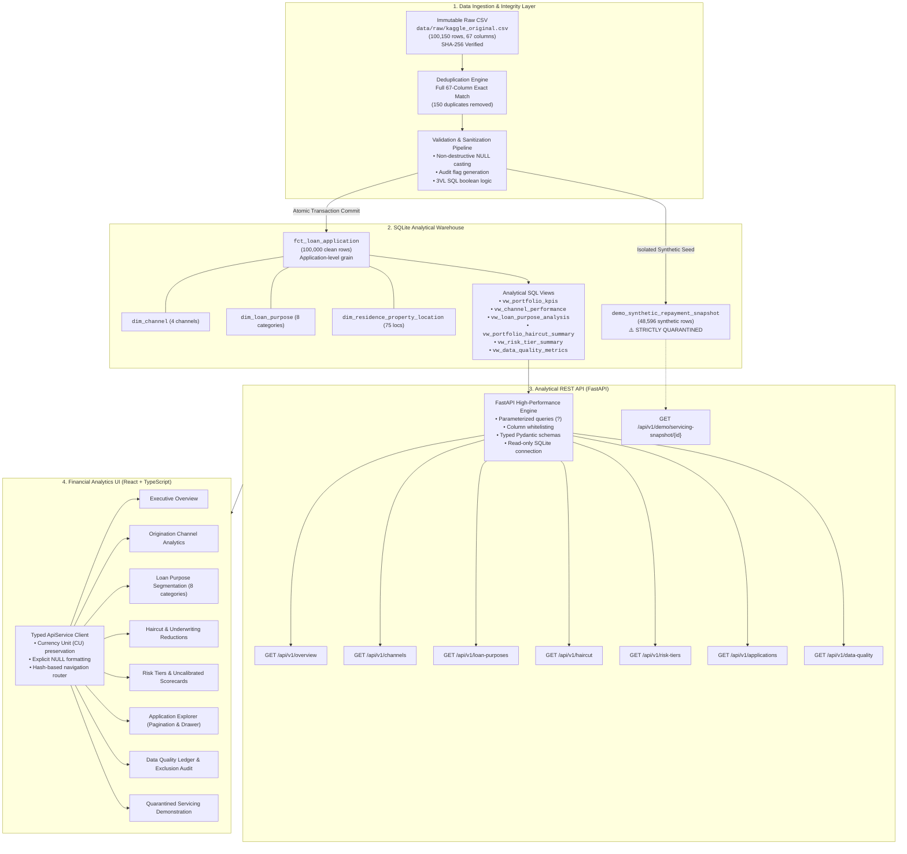

# RiskLens AI — Technical Architecture & System Design

RiskLens AI is an end-to-end financial analytics system and credit underwriting intelligence dashboard designed for auditability, strict data integrity, and forensic transparency.

The platform processes **100,000 credit applications** through an immutable ETL pipeline into an analytical SQLite warehouse, exposes read-only analytical metrics via a FastAPI service, and renders them through a responsive React + TypeScript interface.

---

## 1. System Architecture Diagram

---

## 2. Component Architecture Breakdown

### 2.1 Layer 1: Ingestion & Integrity Engine
- **Immutability Guarantee:** The raw dataset (`data/raw/kaggle_original.csv`) is cryptographically fingerprinted before and after every pipeline execution (`SHA-256: 027a120ef9bb38697331dd6f58dc06a84d86ac59fddcd388e3d37c6222ee076c`). It is opened exclusively in read-only mode and is never modified.
- **Deduplication:** A full 67-column identity check identifies exactly 150 duplicate records out of 100,150 raw rows. All 150 duplicates have identical `Application_ID` values and identical data across all 67 columns with zero field collisions. 100,000 unique records are retained.
- **Sanitization Without Destruction:** Negative financial balances and impossible ages are nullified and flagged rather than silently dropped or forced positive with `ABS()`.

### 2.2 Layer 2: SQLite Warehouse Schema
- **Storage Engine:** SQLite 3 with WAL (Write-Ahead Logging) and enforced foreign-key constraints (`PRAGMA foreign_keys = ON`).
- **Star-Schema Dimensional Model:**
  - `fct_loan_application`: Central fact table containing 100,000 applications.
  - `dim_channel`: 4 conformed channels (`Online`, `Branch`, `Mobile App`, `Agent`).
  - `dim_loan_purpose`: 8 verified loan-purpose categories (`Business`, `Car`, `Debt Consolidation`, `Education`, `Home`, `Medical`, `Personal`, `Vehicle`).
  - `dim_residence_property_location`: 75 distinct geographic combinations.
- **Analytical Views:** Seven views encapsulate aggregations, eliminating join fan-out and providing stable query surfaces.

### 2.3 Layer 3: FastAPI Backend Service
- **Read-Only Access:** The database connection is opened in read-only URI mode (`file:... ?mode=ro`) to eliminate write risk.
- **Injection Defense:** All parameter filters and pagination bounds use parameterized SQLite placeholders (`?`). Sort fields are strictly matched against a static column whitelist.
- **Type Contracts:** Pydantic v2 schemas serialize responses with exact field types, preserving `null` values and enforcing `CU` currency labeling.

### 2.4 Layer 4: React + TypeScript Frontend
- **Framework:** React 18, TypeScript, and Vite, styled with custom Vanilla CSS tailored for financial intelligence.
- **Deep-Linkable Navigation:** Hash routing (`#overview`, `#purposes`, `#haircut`, `#quality`, etc.) allows direct URL linking and automated headless capture without external routing dependencies.
- **Data Fidelity:** Components consume live API responses directly. No mock metrics are presented as real portfolio data.

---

## 3. The Underwriting vs. Servicing Separation Boundary

A key design requirement in institutional credit systems is the strict separation between pre-origination underwriting data and post-origination servicing records:

| Dimension | Primary Underwriting Warehouse | Simulated Servicing Demonstration |
| :--- | :--- | :--- |
| **Database Table** | `fct_loan_application` | `demo_synthetic_repayment_snapshot` |
| **Row Count** | 100,000 records | 48,596 records |
| **Data Nature** | Cleaned applicant origination records | Synthetic downstream repayment simulation |
| **API Namespace** | `/api/v1/overview`, `/api/v1/applications`, etc. | `/api/v1/demo/servicing-snapshot/{id}` |
| **UI Placement** | Primary navigation tabs | Dedicated amber tab labeled "DEMO" |
| **Audit Status** | Production underwriting analytics | Demonstration data notice prominently displayed |

Post-origination servicing records are **strictly quarantined** to prevent them from leaking into origination models, haircut calculations, or executive KPI cards.
