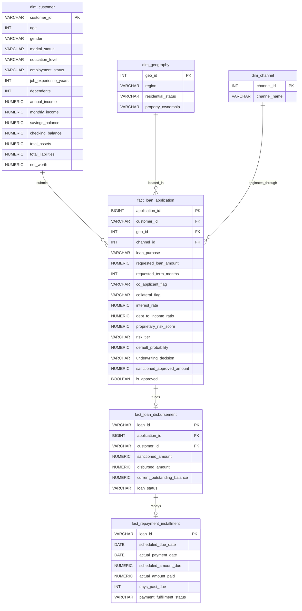

# RiskLens AI — Proposed Analytical SQL Data Model
**Phase 1 Forensic Audit Deliverable**  
**Dataset Source:** `data/raw/kaggle_original.csv`  
**Dataset Dimensions:** 100,150 Rows × 67 Columns (44.61 MB)  
**Status:** Complete Forensic Audit  

---

## 1. Architectural Philosophy: Respecting the Data's True Grain

A critical principle of senior data engineering is **never to invent artificial relational integrity simply to mimic an idealized textbook schema**.

### Forensic Reality Check
- The source dataset is an **application-grain flat table** of 100,000 distinct loan applications.
- All entities (`CUSTOMER`, `LOAN`, `CREDIT`, `REPAYMENT`, `RISK ASSESSMENT`) in Part 2 were generated via deterministic 1:1 synthetic transforms (`'CUST-' || ID`, `'LOAN-' || ID`, `'ASSESS-' || ID`).
- Normalizing this dataset into rigid 3NF tables with strict 1:1 foreign keys introduces pointless `JOIN` latency without reflecting real operational multiplicity.
- Furthermore, **50,907 Rejected applications have synthetic repayment records attached to them**.

### Recommended Architecture: Dimensional Star Schema (Kimball Methodology)
We recommend an **Enterprise Star Schema / Dimensional Warehouse Model** optimized for analytical queries, business intelligence dashboards, and clean risk reporting:
1. **Central Application Fact Table (`fact_loan_application`):** Captures the core origination event at the application grain (100,000 rows).
2. **Disbursement & Accounting Fact Table (`fact_loan_disbursement`):** Captures loan funding and balances strictly for Approved/Funded loans (49,243 rows).
3. **Repayment Installment Fact Table (`fact_repayment_installment`):** Isolates the synthetic repayment snapshot strictly to funded loans, eliminating the 50,907 rejected loan payment contradictions.
4. **Conformed Dimension Tables (`dim_customer`, `dim_credit_profile`, `dim_geography`):** Segment borrower demographics and historical bureau ratings.

---

## 2. Proposed Database Schema Diagram (Mermaid)



---

## 3. Table Specifications & Granularity

### Table 1: `dim_customer` (Customer Demographic & Balance Sheet Dimension)
- **Table Grain:** Exactly 1 row per unique borrower.
- **Estimated Row Count:** Exactly 100,000 rows (post-deduplication).
- **Primary Key:** `customer_id` (`VARCHAR(32)`).
- **Business Purpose:** Centralizes socio-economic background, household dependents, income, and balance sheet strength.
- **DDL Specification:**
  ```sql
  CREATE TABLE dim_customer (
      customer_id VARCHAR(32) PRIMARY KEY,
      age INT CHECK (age >= 18 AND age <= 100),
      gender VARCHAR(10) NOT NULL,
      marital_status VARCHAR(20) NOT NULL,
      education_level VARCHAR(20) NOT NULL,
      employment_status VARCHAR(30) NOT NULL,
      job_experience_years INT CHECK (job_experience_years >= 0),
      dependents INT CHECK (dependents >= 0),
      annual_income NUMERIC(15,2) CHECK (annual_income >= 0),
      monthly_income NUMERIC(15,2) GENERATED ALWAYS AS (ROUND(annual_income / 12.0, 2)) STORED,
      savings_balance NUMERIC(15,2) CHECK (savings_balance >= 0),
      checking_balance NUMERIC(15,2) CHECK (checking_balance >= 0),
      total_assets NUMERIC(15,2) CHECK (total_assets >= 0),
      total_liabilities NUMERIC(15,2) CHECK (total_liabilities >= 0),
      net_worth NUMERIC(15,2) GENERATED ALWAYS AS (total_assets - total_liabilities) STORED,
      bank_account_tenure_months INT CHECK (bank_account_tenure_months >= 0)
  );
  ```

---

### Table 2: `fact_loan_application` (Core Application Grain)
- **Table Grain:** Exactly 1 row per loan application submitted.
- **Estimated Row Count:** Exactly 100,000 rows (post-deduplication).
- **Primary Key:** `application_id` (`BIGINT`).
- **Foreign Keys:**
  - `customer_id` -> `dim_customer(customer_id)`
  - `geo_id` -> `dim_geography(geo_id)`
  - `channel_id` -> `dim_channel(channel_id)`
- **Business Purpose:** Core fact table tracking all submitted requests, underwriting risk scores, credit bureau history, sanction amounts, and approval outcomes.
- **DDL Specification:**
  ```sql
  CREATE TABLE fact_loan_application (
      application_id BIGINT PRIMARY KEY,
      customer_id VARCHAR(32) NOT NULL REFERENCES dim_customer(customer_id),
      geo_id INT NOT NULL,
      channel_id INT NOT NULL,
      loan_purpose VARCHAR(30) NOT NULL,
      requested_loan_amount NUMERIC(15,2) NOT NULL CHECK (requested_loan_amount > 0),
      requested_term_months INT NOT NULL,
      co_applicant_flag BOOLEAN NOT NULL,
      collateral_flag BOOLEAN NOT NULL,
      interest_rate NUMERIC(5,2),
      debt_to_income_ratio NUMERIC(5,2),
      bureau_credit_score INT,
      bureau_existing_loans INT,
      bureau_late_payments_2yr INT,
      bureau_credit_history_years NUMERIC(5,1),
      bureau_prior_loan_status VARCHAR(30),
      proprietary_risk_score NUMERIC(5,2),
      risk_tier VARCHAR(10),
      default_probability NUMERIC(6,4),
      underwriting_decision VARCHAR(15) NOT NULL,
      sanctioned_approved_amount NUMERIC(15,2) NOT NULL DEFAULT 0.00,
      is_approved BOOLEAN GENERATED ALWAYS AS (underwriting_decision = 'Approved') STORED
  );
  ```

---

### Table 3: `fact_loan_disbursement` (Funded Loans Only)
- **Table Grain:** Exactly 1 row per funded loan facility.
- **Estimated Row Count:** Exactly 49,243 rows (Approved loans with disbursement).
- **Primary Key:** `loan_id` (`VARCHAR(32)`).
- **Foreign Key:** `application_id` -> `fact_loan_application(application_id)`
- **Business Purpose:** Isolate operational loan accounts from rejected applications. Eliminates zero-dollar ghost records.
- **DDL Specification:**
  ```sql
  CREATE TABLE fact_loan_disbursement (
      loan_id VARCHAR(32) PRIMARY KEY,
      application_id BIGINT NOT NULL UNIQUE REFERENCES fact_loan_application(application_id),
      customer_id VARCHAR(32) NOT NULL REFERENCES dim_customer(customer_id),
      sanctioned_approved_amount NUMERIC(15,2) NOT NULL,
      disbursed_amount NUMERIC(15,2) NOT NULL CHECK (disbursed_amount > 0),
      current_outstanding_balance NUMERIC(15,2) NOT NULL CHECK (current_outstanding_balance >= 0),
      loan_status VARCHAR(20) NOT NULL DEFAULT 'Active'
  );
  ```

---

### Table 4: `fact_repayment_installment` (Funded Loan Repayment Snapshot)
- **Table Grain:** 1 row per active funded loan installment snapshot.
- **Estimated Row Count:** Exactly 49,243 rows (Approved loans only).
- **Primary Key:** `loan_id` (`VARCHAR(32)`).
- **Foreign Key:** `loan_id` -> `fact_loan_disbursement(loan_id)`
- **Business Purpose:** Isolates scheduled installment obligations, collections, and days past due. **Guarantees zero contamination from rejected applications**.
- **DDL Specification:**
  ```sql
  CREATE TABLE fact_repayment_installment (
      loan_id VARCHAR(32) PRIMARY KEY REFERENCES fact_loan_disbursement(loan_id),
      scheduled_due_date DATE,
      actual_payment_date DATE,
      scheduled_amount_due NUMERIC(15,2) CHECK (scheduled_amount_due >= 0),
      actual_amount_paid NUMERIC(15,2) CHECK (actual_amount_paid >= 0),
      days_past_due INT CHECK (days_past_due >= 0),
      payment_fulfillment_status VARCHAR(20) NOT NULL
  );
  ```

---

## 4. Unverified Relationships & Future Extensibility

1. **Transaction-Level Repayments (1:N):**
   - The current dataset contains only a single simulated payment installment snapshot per loan.
   - If genuine multi-month transaction ledgers are introduced in future phases, `fact_repayment_installment` can seamlessly evolve by introducing an `installment_id BIGINT PRIMARY KEY` or composite key `(loan_id, scheduled_due_date)`.
2. **Customer Multi-Application Journey (1:N):**
   - The proposed schema is fully ready for 1:N customer relationships: `dim_customer` is keyed on `customer_id`, while `fact_loan_application` has a foreign key to `customer_id`.
   - If future data includes repeat applications, the schema supports them without modification.
3. **Geographic Extensibility:**
   - In Phase 1, `dim_geography` stores the 4 macro regions (`West`, `Central`, `South`, `East`). If real municipal zip codes or city data are provided later, they can be added directly to `dim_geography` without altering application facts.
